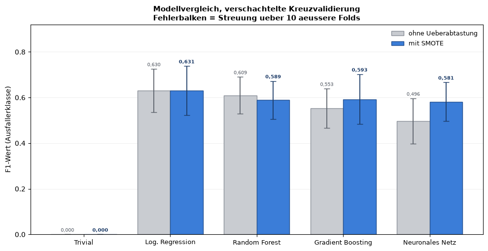
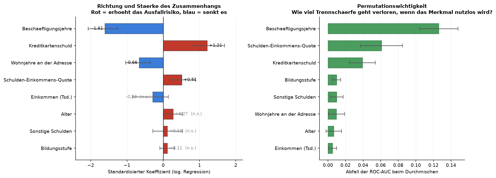
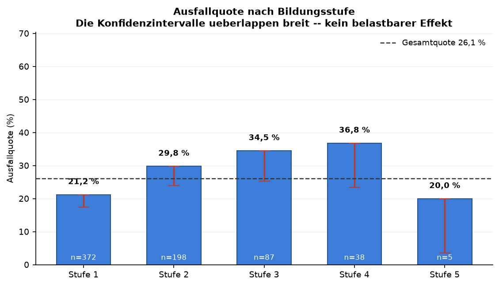

# Credit Risk Analysis — Predicting Loan Default

A credit-risk model on the `bankloans` dataset: which borrower characteristics
predict default, how well can we rank borrowers by risk, and — the part that
actually matters — **where should the decision threshold sit** given that a
missed default costs far more than a false alarm?

📄 **[Full report (PDF)](report/kreditrisiko_bericht.pdf)** · German, 10 pages

## Key findings

**The models rank borrowers far better than the headline F1 suggests.**
Logistic regression reaches **ROC-AUC 0.851** but only F1 0.630 at the default
0.5 threshold. With a 26 % default rate, 0.5 is an arbitrary cut-off.

**Moving the threshold is the real lever.** At 0.5 the model misses 40 of 183
defaults. At the cost-optimal threshold for a 5:1 cost ratio (missed default
five times as expensive as a false alarm), the threshold drops to 0.42 and only
**22 defaults are missed** — recall rises from 0.78 to 0.88.

**Over-sampling (SMOTE) is not a general improvement.** It helps some models
and hurts others; a paired Wilcoxon test over the fold results shows the
differences are mostly not distinguishable from noise.

| Model | F1 | ROC-AUC | PR-AUC |
|---|---:|---:|---:|
| Logistic Regression | 0.630 | 0.851 | 0.706 |
| Random Forest | 0.609 | 0.819 | 0.635 |
| Gradient Boosting | 0.553 | 0.816 | 0.639 |
| Neural Net (MLP) | 0.496 | 0.807 | 0.619 |
| Trivial (majority class) | 0.000 | 0.500 | 0.261 |



**Drivers of default.** Standardised logistic-regression coefficients with
bootstrap confidence intervals:

| Feature | Coefficient | Odds ratio | Significant |
|---|---:|---:|---|
| Employment years | −1.61 | 0.20 | yes |
| Credit-card debt | +1.21 | 3.36 | yes |
| Years at address | −0.66 | 0.52 | yes |
| Debt-to-income ratio | +0.51 | 1.67 | yes |
| Income | −0.29 | 0.75 | no |
| Age | +0.27 | 1.31 | no |

Longer employment and longer residence reduce risk; debt burden raises it.



## A finding worth flagging

The default rate appears to *rise* with education level (21 % → 37 %). That
looks like a strong effect but **is not reliable**: the 95 % confidence
intervals overlap widely, one group has only five observations, and the
correlation between education and debt-to-income ratio is 0.009 — essentially
zero. It is reported as a non-finding, not as a result.



## Data

The dataset (`bankloans`) covers 1,150 rows with 8 features plus the target
`default`. **Only 700 rows carry a label**; the remaining 450 are a block
without a target variable, and they contain just 150 distinct feature patterns
repeated three times each. They are unusable for supervised learning and are
excluded.

The raw file is **not** redistributed here (third-party data). Fetch and verify
it with:

```bash
python3 data/fetch_data.py
```

The script checks row count, column names and default rate, and aborts if the
source has changed. See [`data/README.md`](data/README.md) for provenance and
the canonical source link.

## Method

- **Nested cross-validation** — 10 outer folds for evaluation, an inner
  3-fold step for hyperparameter selection, so the evaluation data is never
  seen by the parameter search. Numbers are measurements, not upper bounds.
- **SMOTE inside the pipeline**, applied only to training folds.
- **Paired Wilcoxon signed-rank tests** on the fold results for every model
  comparison (the folds share the same splits, so they are paired).
- **Cost model** with thresholds derived from expected utility, computed for
  1:1, 5:1 and 10:1 cost ratios.
- **Bootstrap confidence intervals** on the driver coefficients, plus
  permutation importance measured as ROC-AUC drop.

## Structure

```
kreditrisiko/
├── src/
│   ├── common.py          loading, German CSV export, feature metadata
│   ├── 01_describe.py     descriptive statistics + figures
│   ├── 02_models.py       model comparison (nested CV)
│   ├── 03_drivers.py      driver analysis
│   ├── 04_threshold.py    threshold + cost model
│   ├── 05_significance.py paired Wilcoxon tests
│   └── report.py          builds the LaTeX sources and the PDF
├── data/                  README + fetch script (no data committed)
├── figures/               exported figures
├── results/               JSON + German-format CSV outputs
└── report/
    ├── kreditrisiko_bericht.tex   generated main file (do not edit)
    ├── parts/                     one .tex per chapter
    └── kreditrisiko_bericht.pdf   compiled report
```

## Reproduction

```bash
python3 data/fetch_data.py
python3 src/01_describe.py
python3 src/02_models.py
python3 src/03_drivers.py
python3 src/04_threshold.py
python3 src/05_significance.py
python3 src/report.py
```

Requires `scikit-learn`, `imbalanced-learn`, `scipy`, `numpy`, `matplotlib`
and [Tectonic](https://tectonic-typesetting.github.io/) for the PDF.
`src/report.py` writes the LaTeX sources under `report/` and compiles them;
run it with `--no-build` to generate the `.tex` files only.
Result CSVs use German number formatting (decimal comma, semicolon separator,
UTF-8 BOM) for direct import into Power BI with a German locale.

## Limitations

- **Only 700 labelled rows.** Metrics carry fold spread or bootstrap intervals
  but are of limited precision.
- **No time dimension.** There is no observation timestamp, so the model
  predicts membership, not an event at a point in time.
- **The cost model is an assumption.** The 1:1, 5:1 and 10:1 ratios are
  scenarios, not measurements. The right ratio depends on the lender.
- **Association, not causation.** The coefficients describe correlation.

## License

MIT — see [LICENSE](LICENSE). The dataset remains the property of its
publisher and is not redistributed here.
