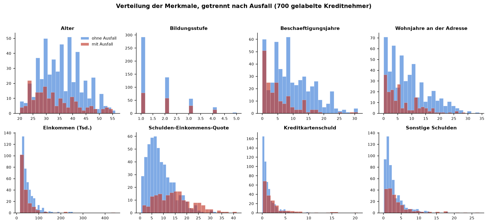
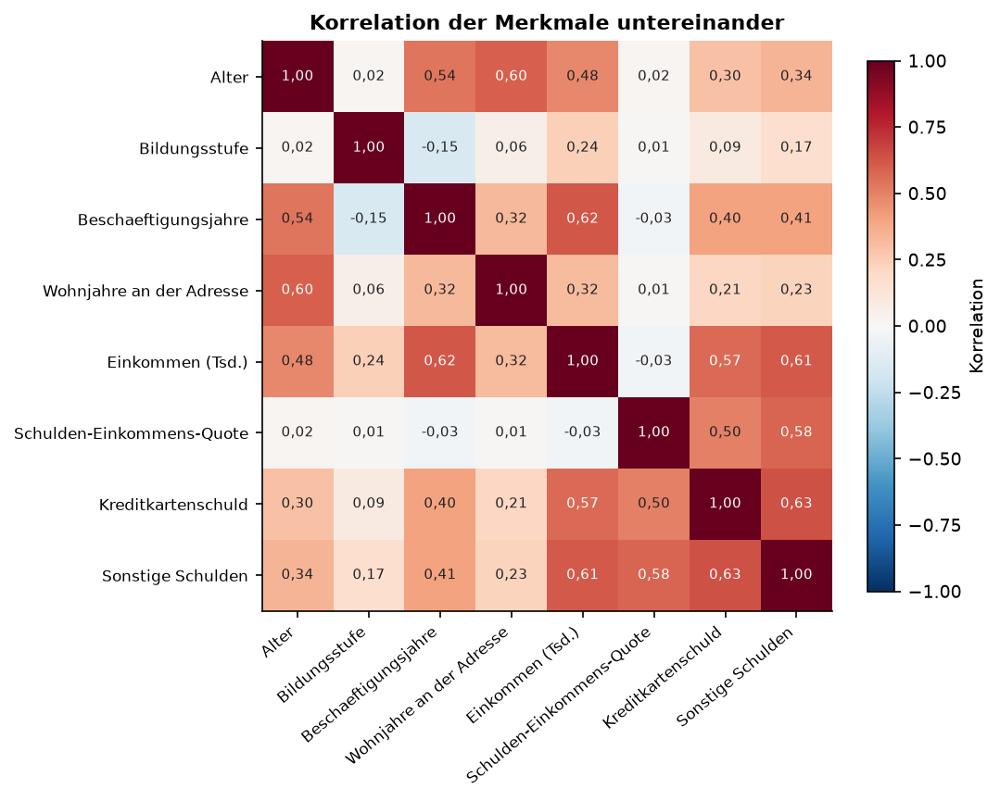
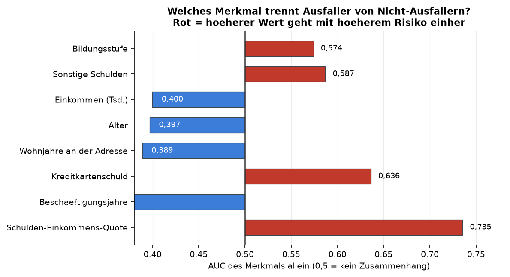
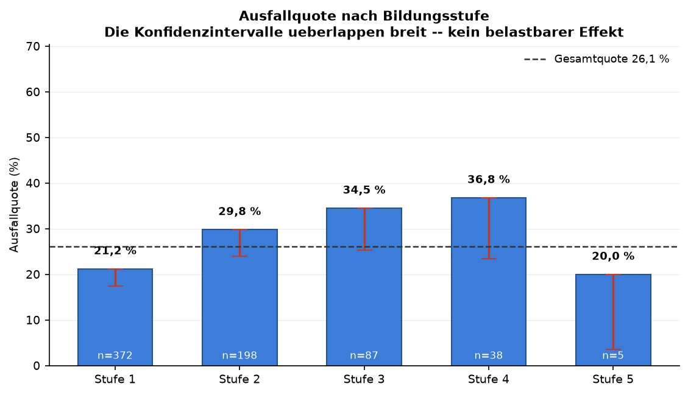
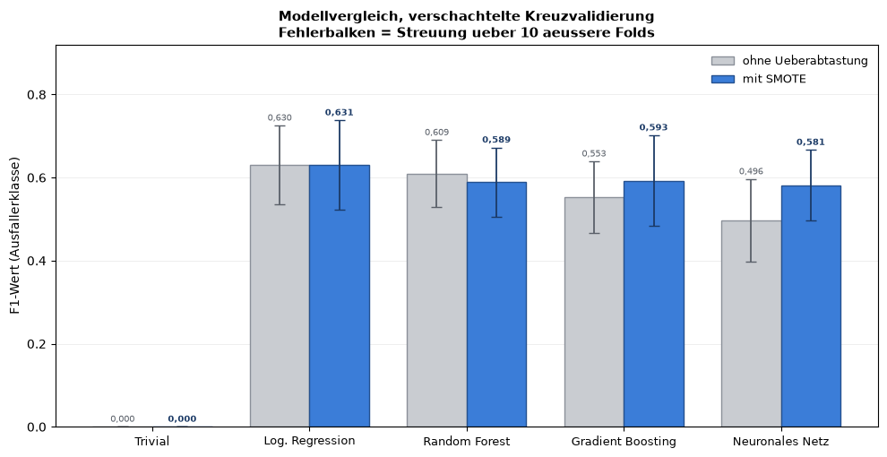
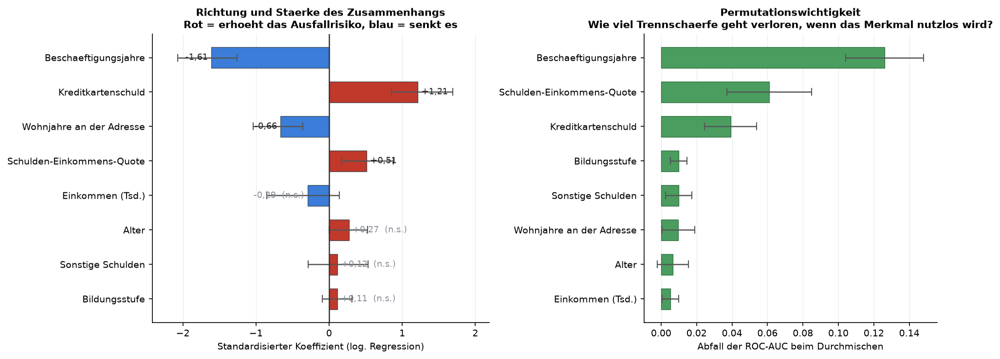
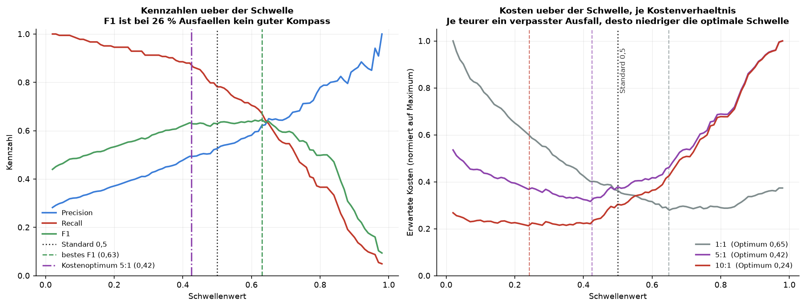
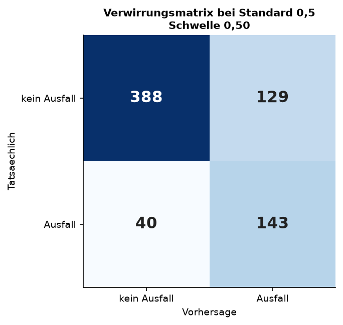
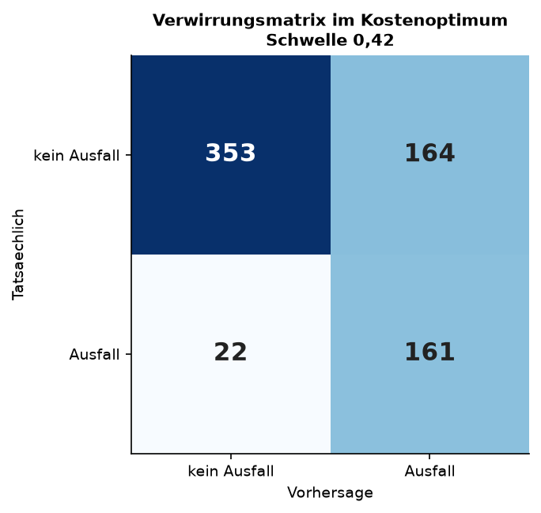

# Kreditrisiko-Analyse

> Erstellt: 2026-11-19 | Datensatz: bankloans (700 gelabelte Kreditnehmer)

## 1. Worum es geht

Aus den Merkmalen eines Kreditnehmers soll vorhergesagt werden, ob er
ausfaellt. Das ist ein **Klassifikationsproblem mit ungleichen Kosten**: Ein
verpasster Ausfall ist teuer, ein Fehlalarm kostet nur eine Pruefung. Der
Bericht misst daher nicht nur die Trennschaerfe, sondern leitet aus einem
Kostenmodell ab, wo die Entscheidungsschwelle liegen sollte.

## 2. Datengrundlage

Der Datensatz umfasst 1150 Zeilen mit acht Merkmalen
(Alter, Bildungsstufe, Beschaeftigungsjahre, Wohnjahre, Einkommen,
Schulden-Einkommens-Quote, Kreditkartenschuld, sonstige Schulden) und der
Zielvariable `default`.

**Nur 700 Zeilen tragen ein Label.** Die uebrigen 450 sind ein Block ohne
Zielvariable; sie enthalten ausserdem nur 150 verschiedene Merkmalsmuster,
jedes dreifach wiederholt. Fuer ueberwachtes Lernen sind sie unbrauchbar und
bleiben aussen vor -- sie dienen hoechstens dem Anwenden eines fertigen
Modells.

Von den 700 gelabelten Kreditnehmern sind **183
ausgefallen (26,1 %)** -- ein moderat ungleicher
Datensatz, kein Extremfall.



*Verteilung der Merkmale, getrennt nach Ausfall. Bei der
Schulden-Einkommens-Quote und der Kreditkartenschuld liegen die Ausfaller
sichtbar rechts, bei den Beschaeftigungs- und Wohnjahren links.*



*Die Merkmale sind untereinander kaum korreliert -- es gibt keine Redundanz,
die eine Auswahl erzwingen wuerde.*

### Was die Merkmale einzeln leisten

Die Trennschaerfe eines Merkmals allein (AUC; 0,5 = kein Zusammenhang):

| Merkmal | AUC allein |
|---|---:|
| debtinc | 0,735 |
| employ | 0,295 |
| creddebt | 0,636 |
| address | 0,389 |
| age | 0,397 |
| income | 0,400 |
| othdebt | 0,587 |
| ed | 0,574 |

Die **Schulden-Einkommens-Quote** trennt am besten, gefolgt von der
Kreditkartenschuld. Die Beschaeftigungsjahre wirken in die andere Richtung:
Je laenger jemand beschaeftigt ist, desto geringer das Risiko.



*Trennschaerfe jedes Merkmals allein. Werte ueber 0,5 heissen: Ein hoeherer
Wert geht mit hoeherem Risiko einher; Werte darunter: mit geringerem.*

### Ein scheinbarer Widerspruch, der keiner ist

Die Ausfallquote steigt mit der Bildungsstufe (Stufe 1: 21,2 %, Stufe 4:
36,8 %). Das sieht nach einem starken Effekt aus, ist aber **nicht
belastbar**: Die Konfidenzintervalle ueberlappen breit, Stufe 5 hat nur fuenf
Beobachtungen, und die Korrelation zwischen Bildungsstufe und
Schulden-Einkommens-Quote betraegt 0,009 --
praktisch null. Der Effekt darf nicht als Befund verkauft werden.



*Ausfallquote je Bildungsstufe mit 95-%-Konfidenzintervall. Der optische
Anstieg haelt der Unsicherheit nicht stand.*

## 3. Methodik

Verglichen werden fuenf Verfahren: Trivialklassifikator (Baseline),
logistische Regression, Random Forest, Gradient Boosting und ein neuronales
Netz -- jeweils ohne und mit Ueberabtastung (SMOTE).

**Verschachtelte Kreuzvalidierung:** Die Bewertung laeuft ueber 10 aeussere
Folds, die Hyperparameterwahl in einem inneren 3-Fold-Schritt. Damit sieht
die Parameterwahl die Bewertungsdaten nie -- die Kennzahlen sind Messungen,
keine Obergrenzen. SMOTE sitzt in der Pipeline und wirkt nur auf die
Trainingsfolds.

**Gepaarter Signifikanztest:** Die Fold-Ergebnisse je Modell beruhen auf
denselben Aufteilungen. Ein Wilcoxon-Vorzeichen-Rang-Test prueft, ob ein
Unterschied groesser ist als die Streuung zwischen den Folds -- strenger als
der optische Vergleich von Fehlerbalken.

## 4. Ergebnisse

### Modellvergleich

| Modell | F1 | ROC-AUC | PR-AUC | Precision | Recall |
|---|---:|---:|---:|---:|---:|
| Trivial (Mehrheitsklasse) (ohne SMOTE) | 0,000 ± 0,000 | 0,500 | 0,261 | 0,000 | 0,000 |
| Trivial (Mehrheitsklasse) (mit SMOTE) | 0,000 ± 0,000 | 0,500 | 0,261 | 0,000 | 0,000 |
| Logistische Regression (ohne SMOTE) | 0,630 ± 0,095 | 0,851 | 0,706 | 0,533 | 0,781 |
| Logistische Regression (mit SMOTE) | 0,631 ± 0,107 | 0,853 | 0,706 | 0,536 | 0,775 |
| Random Forest (ohne SMOTE) | 0,609 ± 0,081 | 0,819 | 0,635 | 0,538 | 0,711 |
| Random Forest (mit SMOTE) | 0,589 ± 0,083 | 0,813 | 0,610 | 0,535 | 0,668 |
| Gradient Boosting (ohne SMOTE) | 0,553 ± 0,086 | 0,816 | 0,639 | 0,648 | 0,487 |
| Gradient Boosting (mit SMOTE) | 0,593 ± 0,109 | 0,816 | 0,619 | 0,580 | 0,618 |
| Neuronales Netz (ohne SMOTE) | 0,496 ± 0,100 | 0,807 | 0,619 | 0,569 | 0,448 |
| Neuronales Netz (mit SMOTE) | 0,581 ± 0,085 | 0,792 | 0,595 | 0,518 | 0,667 |

Das beste Ergebnis erzielt **Logistische Regression + SMOTE** mit F1 = 0,631
(± 0,107) und ROC-AUC = 0,853.



*F1-Wert je Verfahren, ohne und mit Ueberabtastung. Fehlerbalken = Streuung
ueber die zehn aeusseren Folds.*

**Die Modelle ordnen die Kunden deutlich besser, als der F1-Wert vermuten
laesst.** ROC-AUC-Werte um 0,853 heissen: Zieht man
einen zufaelligen Ausfaller und einen zufaelligen Nicht-Ausfaller heraus, wird
der Ausfaller in rund 85,3 % der Faelle
hoeher eingestuft. Der niedrigere F1-Wert entsteht allein durch die feste
Schwelle 0,5 -- dazu Abschnitt 5.

### Bringt Ueberabtastung etwas?

nicht unterscheidbar (p = 0,844) fuer die
logistische Regression; signifikant (p = 0,037)
fuer das neuronale Netz. Ob SMOTE hilft, haengt also von der Konfiguration ab
und ist keine allgemeine Regel.

### Treiber des Ausfalls

Standardisierte Koeffizienten der logistischen Regression (vergleichbar, weil
alle Merkmale dieselbe Skala haben), mit Bootstrap-Konfidenzintervall und
Permutationswichtigkeit:

| Merkmal | Koeffizient | Odds-Ratio | KI95 | signifikant | Perm.-AUC-Abfall |
|---|---:|---:|---|---|---:|
| employ | -1,61 | 0,20 | [-2,07; -1,26] | ja | 0,126 |
| creddebt | 1,21 | 3,36 | [0,85; 1,69] | ja | 0,039 |
| address | -0,66 | 0,52 | [-1,04; -0,36] | ja | 0,010 |
| debtinc | 0,51 | 1,67 | [0,17; 0,88] | ja | 0,061 |
| income | -0,29 | 0,75 | [-0,85; 0,14] | nein | 0,005 |
| age | 0,27 | 1,31 | [-0,00; 0,53] | nein | 0,007 |
| othdebt | 0,12 | 1,12 | [-0,29; 0,53] | nein | 0,010 |
| ed | 0,11 | 1,12 | [-0,10; 0,31] | nein | 0,010 |

Die **Schulden-Einkommens-Quote** und die **Kreditkartenschuld** erhoehen das
Risiko, **Beschaeftigungsjahre** und **Wohnjahre** senken es. Ein
Odds-Ratio von 1,67 bei der Schuldenquote
heisst: Eine Erhoehung um eine Standardabweichung vervielfacht die Chance auf
einen Ausfall etwa um diesen Faktor.



*Links: Richtung und Staerke des Zusammenhangs (standardisiert). Rechts: wie
viel Trennschaerfe verloren geht, wenn ein Merkmal nutzlos gemacht wird.*

## 5. Schwellenwert und Kosten -- der eigentliche Hebel

Bei einem Ausfallanteil von 26,1 % ist die Schwelle
0,5 willkuerlich. Sie wird hier aus dem erwarteten Nutzen abgeleitet:

| Schwelle | Precision | Recall | F1 | TP | FP | FN |
|---|---:|---:|---:|---:|---:|---:|
| 0,5 (Standard) | 0,526 | 0,781 | 0,629 | 143 | 129 | 40 |
| 1:1 | 0,650 | 0,628 | 0,639 | 115 | 62 | 68 |
| 5:1 | 0,495 | 0,880 | 0,634 | 161 | 164 | 22 |
| 10:1 | 0,394 | 0,945 | 0,556 | 173 | 266 | 10 |

**Der Vergleich zeigt den Gewinn.** Bei der Standardschwelle 0,5 werden
143 Ausfaelle erkannt und 40 verpasst. Im Kostenoptimum bei
einem Verhaeltnis von 5:1 liegt die Schwelle bei 0,42: Es
werden 161 Ausfaelle erkannt, nur noch **22 verpasst** -- bei
164 Fehlalarmen. Der Recall steigt von 0,781 auf
0,880.

Je teurer ein verpasster Ausfall im Verhaeltnis zu einem Fehlalarm, desto
niedriger die optimale Schwelle. Die richtige Zahl liegt beim Nutzer; der
Bericht rechnet daher drei Verhaeltnisse durch.



*Links: Precision, Recall und F1 ueber der Schwelle. Rechts: erwartete Kosten
je Kostenverhaeltnis -- je teurer ein verpasster Ausfall, desto weiter wandert
das Optimum nach links.*





*Verwirrungsmatrix bei der Standardschwelle 0,5 (oben) und im Kostenoptimum
5:1 (unten). Der Anteil verpasster Ausfaelle sinkt deutlich.*

## 6. Grenzen

- **Nur 700 Zeilen.** Die Kennzahlen tragen Bootstrap-Intervalle bzw.
  Fold-Streuung, sind aber von begrenzter Praezision.
- **Kein Zeitbezug.** Es gibt keinen Beobachtungszeitpunkt, an dem die
  Merkmale erhoben wurden. Das Modell sagt eine Zugehoerigkeit vorher, kein
  Ereignis zu einem Zeitpunkt.
- **Die 450 ungelabelten Zeilen bleiben ungenutzt.** Sie tragen keine
  Zielvariable; ein halbueberwachter Ansatz waere moeglich, aber nur mit
  zusaetzlicher Annahme.
- **Das Kostenmodell ist eine Annahme.** Die Verhaeltnisse 1:1, 5:1, 10:1
  sind Szenarien, keine Messung.
- **Keine Ursachenaussage.** Die Koeffizienten zeigen Zusammenhang, nicht
  Wirkung.

## 7. Reproduktion

```bash
python3 src/01_describe.py      # Kennzahlen + Abbildungen
python3 src/02_models.py        # Modellvergleich (verschachtelte CV)
python3 src/03_drivers.py       # Treiberanalyse
python3 src/04_threshold.py     # Schwellenwert + Kostenmodell
python3 src/05_significance.py  # gepaarter Wilcoxon-Test
python3 src/report.py           # dieses PDF
```

Die Ergebnisdateien liegen in `results/` (JSON und CSV im deutschen
Power-BI-Format), die Abbildungen in `figures/`.
